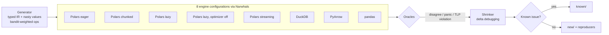

# framebreaker

**A differential and metamorphic fuzzer that finds wrong-result bugs in dataframe engines — Polars, pandas, DuckDB, PyArrow — by making them disagree.**

It writes random queries once, runs them on eight engine configurations through [Narwhals](https://github.com/narwhals-dev/narwhals), and flags any engine that returns a different answer. It then shrinks each failure to a minimal reproducer and generates a ready-to-file bug report.

## Results

In its first **18 minutes of fuzzing** (105,105 generated queries on a MacBook), framebreaker found **12 bugs**: 11 previously unreported, plus one unfixed code path of a known DuckDB issue. It also independently rediscovered 4 known bugs:

| Project | Bug | Impact |
|---|---|---|
| **Polars** | `lit(x) == col` returns 1 row when the column came from a literal — regression since 1.14.0 | silently truncated result / crash |
| **Polars** | `median()` / linear `quantile` returns NaN when the lower middle value is `-inf` | wrong result |
| **DuckDB** | Filters pushed into Arrow scans use Arrow float semantics: `x > 0` drops NaN rows, IN/join filters treat `-0.0 ≠ 0.0` | **rows silently disappear** when querying Arrow tables or Polars DataFrames |
| **DuckDB** | `ConstantExpression(float('nan'))` still becomes `NULL` (bind parameters were fixed in [duckdb#4623](https://github.com/duckdb/duckdb/issues/4623); this path wasn't) | NaN turns into NULL |
| **pandas** | `merge` on numpy `bool` vs `bool[pyarrow]` key with NA raises | crash |
| **Narwhals** | `to_arrow()` on pandas leaks the index once a filter leaves gaps | schema depends on the data |
| **Narwhals** | pandas `lit(None, Boolean)` becomes `False`; `lit(None, Int64)` raises | **wrong data** |
| **Narwhals** | `n_unique()` on an empty DuckDB relation returns `NULL`, not `0` | wrong result |
| **Narwhals** | `str.slice` with negative offsets wrong on DuckDB, PyArrow and pandas | wrong result |
| **Narwhals** | `str.ends_with('')` is `False` on PyArrow | wrong result |
| **Narwhals** | string methods on literal receivers fail on PyArrow/pandas | crash |
| **Narwhals** | null-valued aggregations lose their dtype on PyArrow | downstream crashes |

Rediscovered automatically: [pandas#54911](https://github.com/pandas-dev/pandas/issues/54911), [pandas#59106](https://github.com/pandas-dev/pandas/issues/59106) (also affects Arrow-backed floats), [apache/arrow#26214](https://github.com/apache/arrow/issues/26214), [duckdb#14373](https://github.com/duckdb/duckdb/issues/14373).

Every bug has a standalone reproducer in [`reports/repros/`](reports/repros) and a draft issue in [`reports/`](reports), regenerated from live output by `scripts/build_reports.py`. Each one is also pinned by a regression test in [`tests/test_known.py`](tests/test_known.py), which fails as soon as upstream fixes it.

> Status: drafts, not yet filed upstream. Versions: polars 1.44.2, pandas 3.0.6, pyarrow 25.0.1, duckdb 1.5.6, narwhals 2.26.0.

## How it works



**1. A typed query IR.** Cases are plain JSON: input tables plus a pipeline (`filter`, `with_columns`, `group_by`, `join` ×6 kinds, `sort`, top-k, `unique`, `drop_nulls`, window functions, string ops, casts, `when/then/otherwise`...). A small type checker ([`ir.py`](src/framebreaker/ir.py)) tracks the schema through every op. That lets the generator only build valid queries and the shrinker reject invalid simplifications.

**2. Generation aimed at edge cases.** Small tables full of nulls, `NaN`, `±inf`, `-0.0`, empty strings, combining characters and emoji find far more bugs than big tables of ordinary data. Floats are dyadic rationals, so sums are exact in any order and engines can be compared without loose tolerances. A Thompson-sampling bandit ([`campaign.py`](src/framebreaker/campaign.py)) shifts generation towards operation types that keep producing new findings.

**3. Three oracles** ([`oracle.py`](src/framebreaker/oracle.py)), so a bug can be detected without knowing the right answer:
- **Differential**: all engines must agree. Results are normalized to multisets, unless the query fixes row order. Values and dtypes are compared separately.
- **Polars against itself**: eager vs lazy vs optimizer-off vs streaming vs multi-chunk input. A disagreement points straight at the optimizer or one engine, with no second library involved. This is how the Polars regression surfaced.
- **Ternary logic partitioning** (ported from [SQLancer](https://github.com/sqlancer/sqlancer)): for any predicate `p`, `filter(p) ∪ filter(¬p) ∪ filter(p is null)` must equal the whole result. It checks one engine against itself, so it is immune to legitimate cross-library semantic differences.

**4. Shrinking.** Greedy delta debugging over the IR ([`shrink.py`](src/framebreaker/shrink.py)). It drops ops, chunks of rows and columns, replaces sub-expressions with their children or literals, and swaps values for boring ones. At every step the failure must keep the same *fingerprint*, meaning the same oracle and the same split of engines. A 3,000-row, 5-step failure typically ends as 1–2 rows and 1 op.

**5. Counterfactual triage.** Most raw disagreements are either the same few bugs or *intentional* semantic differences (pandas treats NaN as missing; Polars' `len()` is `u32`; Arrow and DuckDB map `ß → ẞ`). [`known.py`](src/framebreaker/known.py) is a registry of 21 triaged issues that doubles as an **atlas of where dataframe libraries disagree**.

Matching patterns alone is dangerous: "the data contains NaN" does not mean NaN *caused* the disagreement. So 10 entries carry a transform that removes their cause while keeping the query meaningful: NaN/∞ become ordinary numbers; `-0.0` becomes `0.0` (with computed floats wrapped in `+ 0.0` so arithmetic can't recreate it); literals become real columns; literals move to the other side of a comparison. A finding counts as explained only if **removing the cause makes the disagreement disappear**. A backend that is wrong for two reasons at once is handled by peeling: remove one confirmed cause, re-run, and explain what's left. A counterfactual proves cause but not blame, so when several engines could be "the wrong one", the explanation that relies least on generic by-design rules wins.

This changed the results. The first version used patterns only and reported 0 unexplained findings, but it was hiding two real bugs. Re-triaging all 2,026 saved findings counterfactually surfaced a **new Polars bug** (median with `-inf`, behind 24 findings that had been filed as "NaN semantics") and a **known pandas bug** (#59106, behind 39). One finding remains for manual triage. `tests/test_known.py` plants a bug in a case that also contains NaN, and checks that pattern-only triage hides it while counterfactual triage doesn't.

**6. Robust campaigns.** Workers run in separate processes. Before each query a worker records the case it's about to run, so a segfault or hang still leaves the exact input behind; the parent saves it and restarts the worker. Findings that don't reproduce after shrinking are kept as `flaky` with their original input, never silently dropped.

**7. Reproducers in each project's own terms.** For every finding: a native **Polars** script (no Narwhals) for the relevant engine mode, the **SQL** that DuckDB actually ran (`CREATE TABLE … INSERT …` + query), and a cross-engine script.

## Quick start

```bash
uv sync
uv run framebreaker fuzz --seconds 300 --workers 8   # run a campaign
uv run framebreaker list                              # unexplained findings
uv run framebreaker show <id>                         # report + reproducers
uv run framebreaker replay <id>                       # re-check on installed versions
uv run framebreaker known                             # the semantic-differences atlas
uv run pytest                                         # 27 tests, incl. planted-bug tests
```

## Engineering notes

- **Planted-bug tests.** `tests/test_core.py` injects a fake bug, such as null ints read as 0 or `NOT(null)` evaluated as true, and asserts the fuzzer finds it, shrinks it to ≤2 rows and ≤2 ops, and that TLP catches it with no reference engine. This proves the pipeline works, independent of whether upstream libraries currently have bugs.
- **Root-causing, not just reporting.** Each report names the faulty code path. Examples: DuckDB's pushed-down IN filter becomes `pyarrow.compute.is_in`; pandas' `_factorize_keys` uses `na_value=1` for Arrow bool keys; Narwhals' `ends_with` slices with `-len(suffix)` and `-0 == 0`. The Polars regression was bisected to 1.14.0.
- **Throughput.** Checking runs at ~180 queries/s per core, each query on 8 engine configurations plus TLP variants. Full campaigns, where most time goes into shrinking findings, sustain ~100 queries/s on 7 workers.

## Limitations

- Polars is treated as the reference semantics, because Narwhals follows the Polars API. Where Polars is the odd one out, the classifier still considers every group.
- Rules without a removable cause (e.g. DuckDB's `n_unique` on empty input, PyArrow's approximate median, pandas NaN-as-missing) are still pattern-based, so they can in principle hide a new bug in the same region. Polars-internal disagreements are only explained when a counterfactual confirms the cause.
- Errors whose message says "not supported" are treated as unsupported and excluded from comparison, which keeps noise down but would also hide an engine wrongly refusing a valid query.
- Datetime, decimal, nested and categorical types aren't generated yet; they're the obvious next bug-rich area.
